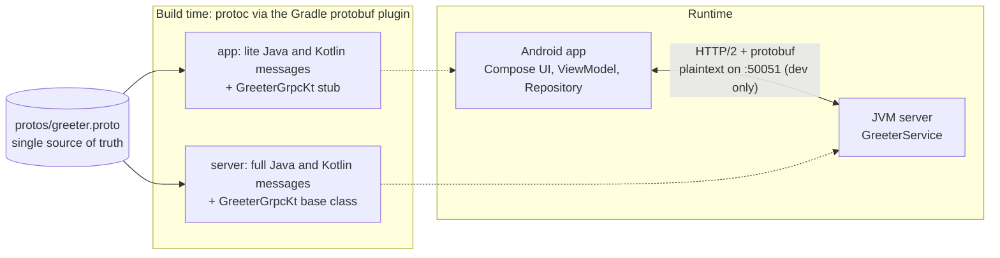
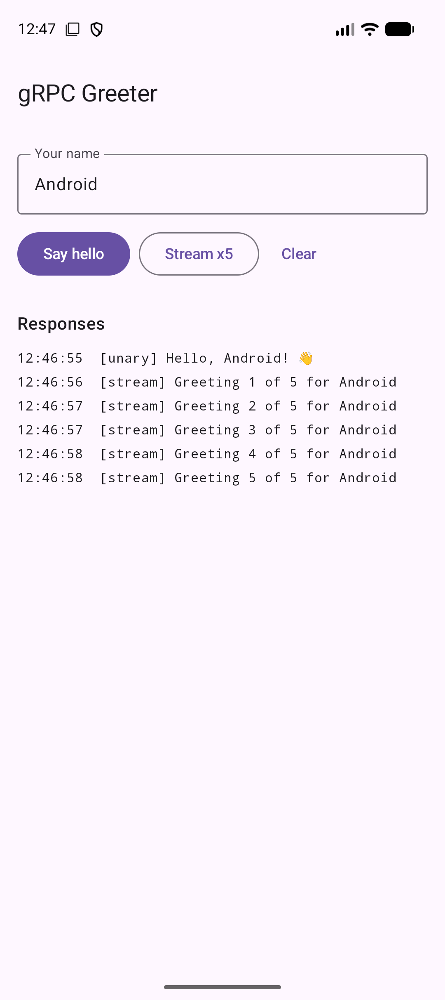
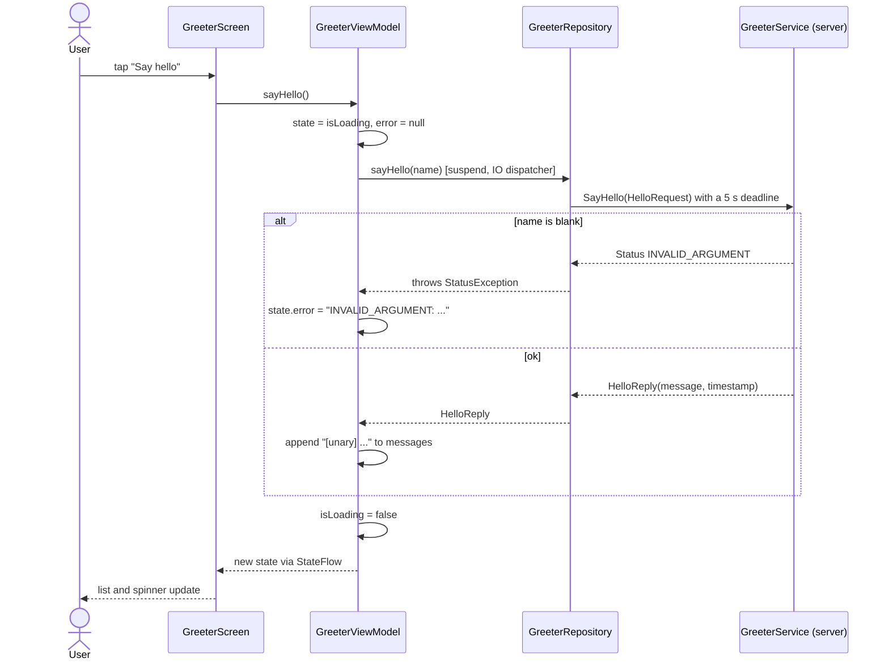
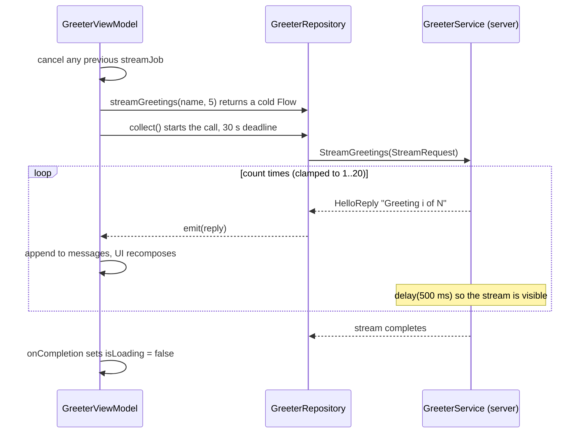

# gRPC Android Sample

A small, end-to-end experiment in calling **gRPC from an Android app** written in Kotlin and Jetpack Compose. The repo has three parts that share one contract: the Android client, a local Kotlin gRPC server to talk to, and a `.proto` file that defines the API.

- [What this experiment explores](#what-this-experiment-explores)
- [Background: gRPC in 2 minutes](#background-grpc-in-2-minutes)
- [Architecture](#architecture)
- [What it looks like](#what-it-looks-like)
- [How a request flows](#how-a-request-flows)
- [Walkthrough of the code](#walkthrough-of-the-code)
- [Run it](#run-it)
- [Try the server without the app](#try-the-server-without-the-app)
- [Design decisions](#design-decisions)
- [Going to production](#going-to-production)
- [Adding your own RPCs](#adding-your-own-rpcs)
- [Versions](#versions)
- [Troubleshooting](#troubleshooting)

## What this experiment explores

| Question | Where it is answered |
|---|---|
| How do I share one API contract between an Android app and a JVM server? | `protos/` module, consumed by both `app` and `server` |
| Which gRPC transport and protobuf runtime should Android use? | `app/build.gradle.kts`: OkHttp transport and the **lite** protobuf runtime |
| How do coroutines fit with gRPC? | grpc-kotlin: unary calls are `suspend` functions, server streams are `Flow` |
| How do I show a live stream in Compose without leaking work? | `GreeterViewModel`: a `StateFlow` plus a cancellable stream `Job` |
| How do I test a gRPC server without writing a client? | Server reflection plus `grpcurl` |

## Background: gRPC in 2 minutes

**gRPC** is a remote-procedure-call framework. You describe your API once in a `.proto` file (services, methods, and message types). A code generator then produces typed client stubs and server base classes, so calling the server looks like calling a local function.

Under the hood it runs over **HTTP/2** and serializes messages with **Protocol Buffers**, a compact binary format. HTTP/2 allows many calls over one connection and allows streaming in either direction.

gRPC has four call shapes. This sample implements the first two:

| Shape | Request | Response | In this repo |
|---|---|---|---|
| Unary | 1 message | 1 message | `SayHello` |
| Server streaming | 1 message | N messages over time | `StreamGreetings` |
| Client streaming | N messages | 1 message | not implemented |
| Bidirectional streaming | N messages | N messages | not implemented |

## Architecture

```
GrpcAndroidSample/
├── protos/   The contract. Packages greeter.proto so both sides generate code from it.
├── server/   Kotlin/JVM gRPC server (Netty transport) listening on :50051
└── app/      Android client (OkHttp transport, protobuf-lite, coroutine stubs, Compose UI)
```



### Module responsibilities

| Module | Plugin | Role |
|---|---|---|
| `:protos` | `java-library` | Ships the `.proto` files as resources. No generated code lives here. |
| `:server` | `kotlin-jvm`, `application`, `protobuf` | Generates server-side code, implements `Greeter`, runs `main()`. |
| `:app` | `android-application`, `kotlin-compose`, `protobuf` | Generates client-side **lite** code, hosts the UI. |

Each consumer pulls the contract in with `protobuf(project(":protos"))`, so editing the `.proto` once regenerates both sides on the next build.

## What it looks like

The screen is one text field, three buttons, and a scrolling log of responses.



This capture was taken on an emulator after tapping **Say hello** once and **Stream x5** once. The first line is the unary reply. The next five are the server stream, with timestamps about half a second apart.

📹 **[Watch the screen recording](docs/demo.mp4)** (about 12 s).

To re-capture these yourself, with the app running on an emulator:
```bash
adb exec-out screencap -p > docs/screenshot.png
adb shell screenrecord --time-limit 12 /sdcard/demo.mp4 && adb pull /sdcard/demo.mp4 docs/demo.mp4
```

## How a request flows

### Unary: "Say hello"



### Server streaming: "Stream x5"



Because the repository returns a **cold `Flow`**, no network call happens until the ViewModel collects it. If the ViewModel is cleared or the user starts a new stream, coroutine cancellation propagates down and cancels the in-flight RPC.

## Walkthrough of the code

### The contract: `protos/src/main/proto/greeter/greeter.proto`

```proto
service Greeter {
  rpc SayHello (HelloRequest) returns (HelloReply);                  // unary
  rpc StreamGreetings (StreamRequest) returns (stream HelloReply);   // server streaming
}
```

Messages: `HelloRequest{name}`, `StreamRequest{name, count}`, and `HelloReply{message, timestamp_millis}`.

### The server: `server/.../GreeterServer.kt`

- `GreeterService` extends the generated `GreeterCoroutineImplBase`, so handlers are `suspend` functions and `Flow`s with no observers or callbacks.
- `sayHello` trims the name and rejects an empty one with `Status.INVALID_ARGUMENT`. This is how you return a typed error to the client.
- `streamGreetings` clamps `count` to 1..20, emits one reply per iteration, and `delay(500.milliseconds)` between them to simulate work.
- `GreeterServer` registers the service plus `ProtoReflectionService`, which lets tools like `grpcurl` discover the API at runtime.
- The port comes from the `PORT` environment variable and defaults to `50051`. A shutdown hook stops the server cleanly.

### The client

| File | Responsibility |
|---|---|
| `data/GreeterRepository.kt` | Owns the `ManagedChannel` (`OkHttpChannelBuilder`, keep-alive every 30 s) and the generated `GreeterCoroutineStub`. Sets a deadline on every call: 5 s for unary, 30 s for streaming. Moves work to `Dispatchers.IO`. |
| `ui/GreeterViewModel.kt` | Holds `GreeterUiState` in a `StateFlow`. Launches calls in `viewModelScope`, turns `StatusException` into a readable message, keeps the stream `Job` so it can be cancelled, and closes the channel in `onCleared()`. |
| `ui/GreeterScreen.kt` | Stateless Compose UI. Reads state with `collectAsStateWithLifecycle()` and sends events up to the ViewModel. Buttons are disabled while loading. |
| `MainActivity.kt` | Edge-to-edge `ComponentActivity` that hosts `GreeterScreen`. |

### Code generation

The `com.google.protobuf` Gradle plugin runs `protoc` with three generators: the protobuf Java and Kotlin builtins, `protoc-gen-grpc-java`, and `protoc-gen-grpc-kotlin`. The two modules are configured differently on purpose:

| | `app` (Android) | `server` (JVM) |
|---|---|---|
| Protobuf runtime | **lite** (`option("lite")`): smaller APK, no reflection-heavy descriptors | full |
| Transport | `grpc-okhttp` | `grpc-netty-shaded` |
| Extras | none | `grpc-services` for reflection |

Generated sources land under each module's `build/generated/source/proto/`. You never edit them.

## Run it

**Requirements:** Android Studio with Android SDK 35 and JDK 17 or newer. Use an Android Studio version that supports the AGP version listed under [Versions](#versions).

1. **Open the project** in Android Studio (File → Open → `GrpcAndroidSample`) and let Gradle sync.
2. **Start the server** from the project root:
   ```bash
   ./gradlew :server:run
   ```
   You should see `Greeter server listening on port 50051`.
3. **Run the `app` configuration** on an Android **emulator**. It connects to `10.0.2.2:50051`, the emulator's alias for your computer.
4. Tap **Say hello** for one reply. Tap **Stream x5** and watch five replies arrive half a second apart.

To see an error, clear the name field and tap **Say hello**. The server rejects it, and the app shows `INVALID_ARGUMENT: name must not be empty` in red.

### Using a physical device

Either forward the port over USB:
```bash
adb reverse tcp:50051 tcp:50051
```
and change `GRPC_HOST` in `app/build.gradle.kts` to `"127.0.0.1"`, **or** set `GRPC_HOST` to your computer's LAN IP (e.g. `192.168.1.20`) and add that IP to `app/src/main/res/xml/network_security_config.xml`.

## Try the server without the app

The server enables reflection, so [grpcurl](https://github.com/fullstorydev/grpcurl) works with no `.proto` on hand:

```bash
grpcurl -plaintext localhost:50051 list                       # discover services
grpcurl -plaintext localhost:50051 describe greeter.Greeter   # show methods
grpcurl -plaintext -d '{"name":"World"}' localhost:50051 greeter.Greeter/SayHello
grpcurl -plaintext -d '{"name":"World","count":3}' localhost:50051 greeter.Greeter/StreamGreetings
```

## Design decisions

| Decision | Why |
|---|---|
| Separate `:protos` module | One contract, no copy-pasted `.proto` files. Both sides regenerate when it changes. |
| Lite runtime on Android | Smaller binary and fewer methods. It is the runtime gRPC recommends for mobile. |
| OkHttp transport on Android | Netty is heavy and not meant for Android. OkHttp is the supported Android transport. |
| grpc-kotlin coroutine stubs | Idiomatic `suspend` and `Flow` APIs instead of `StreamObserver` callbacks. |
| Deadlines on every call | gRPC calls have no timeout by default, so a hung server would hang the UI indefinitely. |
| Cold `Flow` for streams | The call starts on collection and is cancelled automatically with the collector. |
| Cleartext only for local addresses | `network_security_config.xml` allows plaintext only to `10.0.2.2`, `localhost`, and `127.0.0.1`. |
| Server reflection on | Makes manual testing with `grpcurl` effortless. Consider disabling it in production. |

## Going to production

- **Use TLS.** Create the repository with `useTls = true` (it calls `useTransportSecurity()`), and remove the cleartext entries from `network_security_config.xml`.
- **Add auth** with a `ClientInterceptor` that attaches a token to `Metadata`, or with `CallCredentials`.
- **Share one channel** per backend for the app's lifetime (for example provided by DI). Today each `GreeterViewModel` creates its own, which is fine for a sample but wasteful in a real app.
- **Handle more than `StatusException`.** The unary path catches only `StatusException`, so other failures can escape. Add retry and backoff for `UNAVAILABLE`.
- **Review R8 rules** before enabling minification. `isMinifyEnabled` is currently `false`.

## Adding your own RPCs

1. Edit or add `.proto` files under `protos/src/main/proto/`.
2. Rebuild. The stubs regenerate for both `app` and `server`.
3. Override the new method in `GreeterService` (`server/.../GreeterServer.kt`).
4. Call it from `GreeterRepository`, expose it through the ViewModel, and wire it into the UI.

## Versions

Pinned in `gradle/libs.versions.toml`:

| Component | Version |
|---|---|
| Android Gradle Plugin | 9.5.1 |
| Kotlin | 2.2.10 |
| gRPC-Java | 1.68.1 |
| gRPC-Kotlin | 1.4.1 |
| Protobuf | 4.28.3 |
| Protobuf Gradle plugin | 0.9.4 |
| kotlinx-coroutines | 1.9.0 |
| Compose BOM | 2024.12.01 |

Keep the gRPC, protobuf, and gRPC-Kotlin versions in step when you upgrade. `minSdk` is 24 and `compileSdk` and `targetSdk` are 35.

## Troubleshooting

| Symptom | Likely cause and fix |
|---|---|
| App shows `UNAVAILABLE` | The server is not running, or the app cannot reach the host. On an emulator use `10.0.2.2`. On a device, use `adb reverse` or a LAN IP. |
| `Cleartext HTTP traffic not permitted` | The host is missing from `network_security_config.xml`. |
| `DEADLINE_EXCEEDED` | The call took longer than its deadline (5 s unary, 30 s streaming). |
| `INVALID_ARGUMENT: name must not be empty` | Expected. The server rejects blank names. |
| `Address already in use` on server start | Port 50051 is taken. Run with `PORT=50052 ./gradlew :server:run` and update `GRPC_PORT` in the app. |
| Generated classes not found | Run a Gradle sync, then rebuild. Generation happens in the build, not at edit time. |
